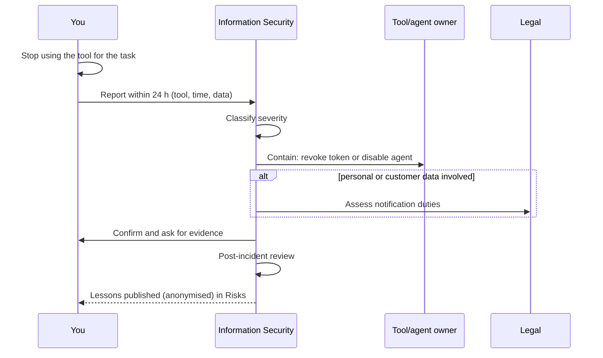

## Overview

Early reports beat late ones, and reporting is blameless. Follow the [incident reporting policy](/policies/incident-reporting/) for the full rules.

## Severity guide

| Severity | Examples | Target response |
| --- | --- | --- |
| High | Restricted data left the network, agent took destructive action | 1 hour |
| Medium | Confidential data in an unapproved tool | 1 working day |
| Low | Harmless wrong output, no data involved | 3 working days |
