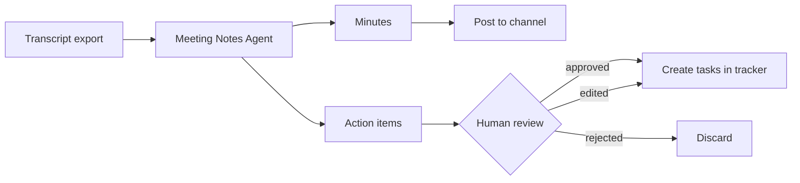

## Overview

Chains the [Meeting Notes Agent](/agents/meeting-notes-agent/) with your task tracker so action items do not live only in a chat message.



## Setup

1. Install the agent following its [Install tab](/agents/meeting-notes-agent/#install).
2. Create the webhook in your channel and export the variables:

```bash
export CHAT_WEBHOOK_URL="https://chat.example.org/hooks/xxxx"
export TRACKER_PROJECT="TEAM"
```

3. Run the pipeline after each meeting:

```bash
./meeting-to-actions.sh transcripts/standup.vtt
```

## Guardrails

- Tasks are created **only after a human approves** the list.
- Do not use it for HR, legal or customer-confidential meetings.
