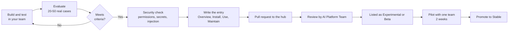

## Overview

An agent is listed once it has an owner, documentation and an evaluation. Use the [evaluation guide](/library/evaluating-agents/) before you start.

## Checklist before the pull request

- [ ] Named owner and support channel
- [ ] Evaluation results attached
- [ ] Least-privilege permissions documented
- [ ] Data it sees and stores described
- [ ] Rollback or retirement steps written
