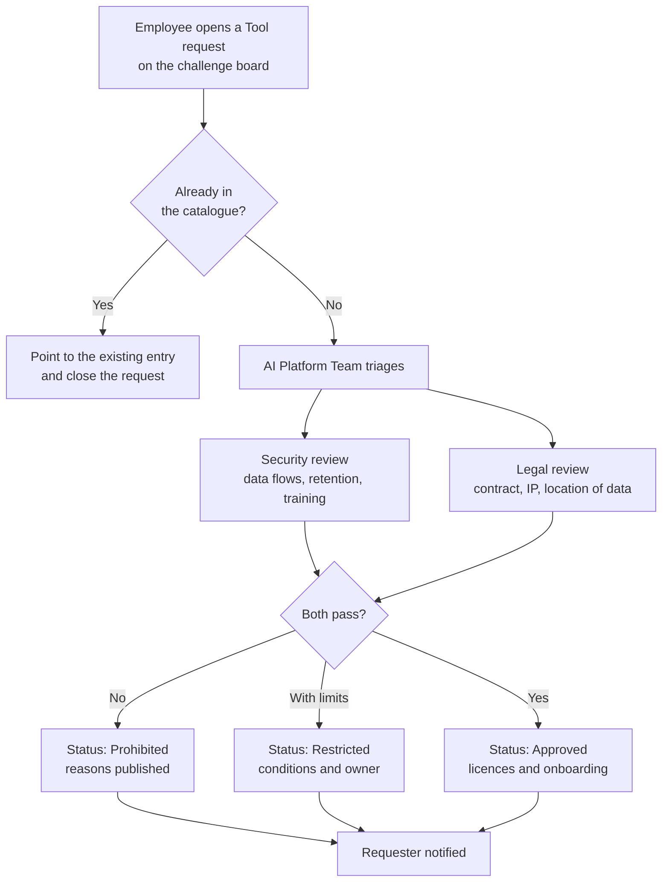

## Overview

Anyone can propose a tool. The AI Platform Team coordinates the review with Information Security and Legal. The target is a decision within **15 working days**.

## Who does what

| Step | Owner | Output |
| --- | --- | --- |
| Submit request | Requester | Use case, data involved, expected users |
| Triage | AI Platform Team | Duplicate check, priority |
| Security review | Information Security | Data-flow assessment |
| Legal review | Legal | Contract and licence terms |
| Publish | AI Platform Team | Catalogue entry and news item |

## Tips for a fast decision

- State the **data classification** you expect to use ([data classification](/policies/data-classification/)).
- Describe the problem, not only the product.
- Rally votes: the board orders requests by votes.
