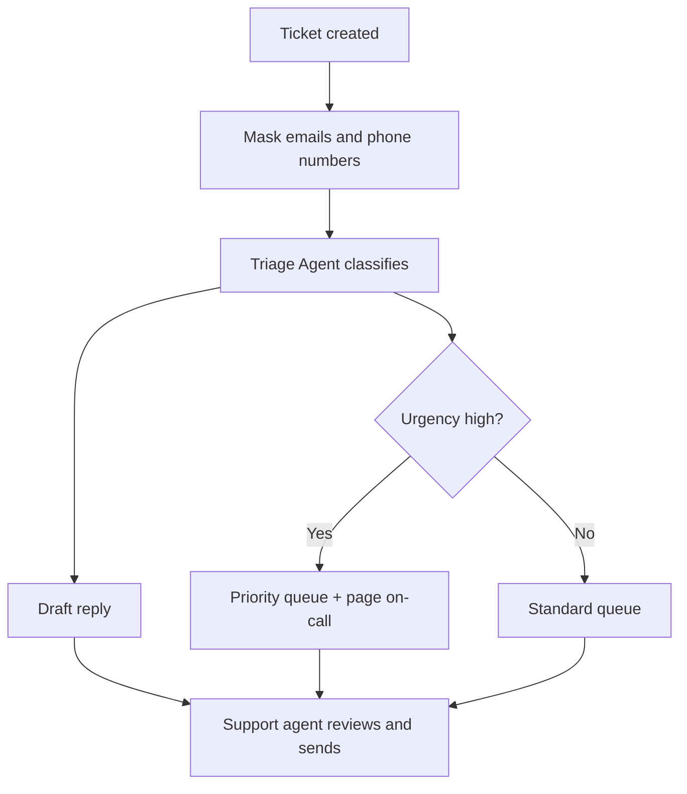

## Overview

Experimental flow used by pilot teams only. It never sends a reply by itself.

## Notes

- Restricted data must not enter the flow; masking is a safety net, not a licence to send it.
- Review the weekly misclassification report and update `labels.yml`.
